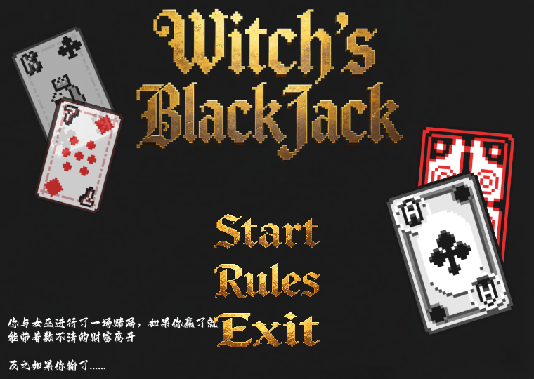
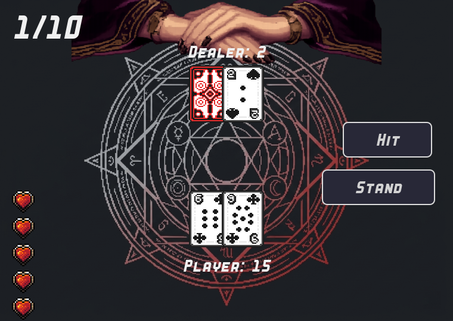
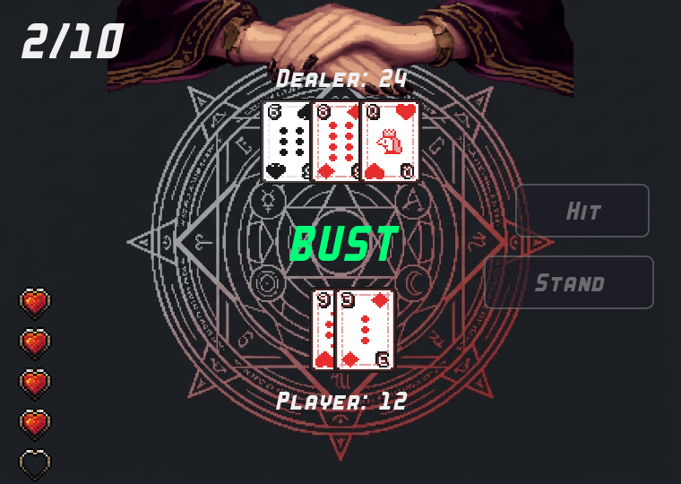

# Witch's Blackjack
### A Dark Fantasy Blackjack Survival Game
### 黑暗奇幻风格的 21 点生存游戏

 

<!-- 截图来自实际运行画面，见 screenshots/ 目录 -->

| 主菜单 Menu | 牌桌对局 Gameplay |
| --- | --- |
|  |  |

| 结算/结束 Result |
| --- |
|  |

---

## English

### 1. Introduction

**Witch's Blackjack** is a dark-fantasy Blackjack card survival game built with **Godot 4 and GDScript**. You play a high-stakes Blackjack duel against the dealer — not for chips, but for your life.

The game was originally prototyped in **Python / Pygame** and later fully migrated to **Godot 4** through an AI-assisted development workflow (see [AI-assisted Workflow](#6-ai-assisted-workflow) and [MIGRATION_NOTES.md](MIGRATION_NOTES.md)).

### 2. Gameplay

- Standard **52-card deck**, reshuffled every round
- Classic **Blackjack** rules with correct Ace handling (11 or 1, auto-optimized)
- **Hit / Stand** actions (keyboard + mouse)
- **Dealer AI**: must draw below 17, must stand at 17+
- **10-round survival** run with **5 lives** — lose a round, lose a heart
- Dealer's hole card stays hidden until the dealer acts
- Initial Blackjack judgement for both player and dealer (push / win / lose)
- Survive all 10 rounds with at least 1 life left and **YOU WIN**
- Results: WIN / LOSE / PUSH / BUST / BLACKJACK with a full game-over screen

> This is the completed core game. Roguelike extensions are planned but **not** part of the current build (see Roadmap).

### 3. Controls

| Key | Action |
| --- | --- |
| `H` | Hit |
| `S` | Stand |
| `R` | Restart (game-over screen only) |
| `ESC` | Exit (game-over screen only) / back to menu (Rules page) |
| `←` / `→` | Rule page navigation |

### 4. Technology Stack

- **Godot 4** (4.7.2) — game engine
- **GDScript** — game logic & UI
- **Python / Pygame** — original prototype
- **Git** — version control
- **AI-assisted Development** — code migration & generation (see below)
- **MCP (Model Context Protocol)** — Godot editor automation used during development & QA

### 5. Project Architecture

```
GitHub_Source/
├── project.godot            # 760×540, canvas_items stretch + keep aspect
├── assets/
│   ├── backgrounds/         # menu & table backgrounds
│   ├── cards/               # 52 card faces + WB.png card back
│   ├── ui/                  # button images & heart icons
│   ├── rules/               # rule page images
│   └── fonts/               # Ziti.ttf
├── scenes/
│   ├── main/MainMenu.tscn
│   ├── rules/Rules.tscn
│   ├── game/Game.tscn
│   └── components/CardView.tscn
├── scripts/
│   ├── core/                # pure logic, no UI dependency
│   │   ├── CardData.gd      #   card data
│   │   ├── Deck.gd          #   deck: build / shuffle / deal
│   │   ├── Participant.gd   #   player & dealer hands
│   │   └── BlackjackRules.gd#   rules as static pure functions
│   ├── managers/
│   │   └── GameController.gd#   round flow, lives, signal-driven
│   ├── ui/                  # GameScreen / MainMenu / Rules / CardView
│   │                        # HeartDisplay / ResultOverlay
│   └── utilities/
│       └── AssetManager.gd  # cached texture & resource access
└── tests/
    ├── run_tests.gd         # 61 logic assertions (headless)
    └── ui_views_test.gd     # 22 UI view integration assertions
```

Game logic (rules / deck / flow) is fully separated from UI; `BlackjackRules.gd` and `GameController.gd` can be tested headless without opening a single scene.

### 6. AI-assisted Workflow

This project was developed with AI as a **development assistant**:

- **Code migration**: the original Pygame code was analyzed line-by-line and re-implemented as modular GDScript (not translated 1:1).
- **GDScript code generation & refactoring**: scenes, scripts and signal wiring were drafted by AI, then verified by running.
- **Error diagnosis**: runtime errors, layout issues (TextureRect expand-mode pitfall) and signal bugs were located via editor logs and headless tests.
- **Godot MCP workflow**: the AI connected to the running Godot editor through MCP to run the game, inject input, and capture screenshots automatically during QA.
- **Human role**: game design, art assets, feature planning, integration decisions and final acceptance were made by the developer.

AI is a tool here — every feature was actually executed and verified before being considered done.

### 7. Screenshots

All screenshots above are captured from the real running game.

### 8. Installation & Running (source)

1. Install [Godot 4.x](https://godotengine.org/download) (developed on 4.7.2)
2. Clone / download this repository
3. Open `project.godot` with the Godot editor and wait for asset import
4. Press **F5** to run the main scene

### 9. Download (players)

Windows players don't need Godot: download `WitchBlackjack_Windows_x64.zip` from the **GitHub Releases** page, unzip, and double-click `WitchBlackjack.exe`. (See `README_RUN.txt` inside the package.)

### 10. Roadmap

**Completed:**
- ✅ Full Blackjack core game (10-round survival, 5 lives)
- ✅ Dealer AI with hole-card reveal
- ✅ Godot 4 migration with headless test suites

**Planned features** (Roguelike expansion — *not yet implemented*):
- 🔜 Roguelike progression
- 🔜 Relic system
- 🔜 Ticket system
- 🔜 Special Boss encounters
- 🔜 Random events

### 11. License

**License status: pending audit.** Art assets and the bundled font were created/collected for the original project; their redistribution terms still need confirmation from the author. See [ASSET_LICENSE_AUDIT.md](ASSET_LICENSE_AUDIT.md). No open-source license is applied to this repository until that audit is resolved.

---

## 中文

### 1. 项目简介

**Witch's Blackjack（女巫的 21 点）** 是一款黑暗奇幻风格的 21 点卡牌生存游戏，使用 **Godot 4 + GDScript** 开发。你与庄家进行以生命为赌注的 21 点对决——赌的不是筹码，是命。

本项目原型最初由 **Python / Pygame** 开发并已交付玩家试玩，之后完整迁移到 **Godot 4**（迁移记录见 [MIGRATION_NOTES.md](MIGRATION_NOTES.md)）。

### 2. 玩法

- 标准 **52 张扑克牌**，每轮重新洗牌
- 经典 **21 点规则**，A 按 11/1 自动优化计分
- **要牌 / 停牌**（键盘 + 鼠标）
- **庄家 AI**：低于 17 必须要牌，达到 17 必须停牌
- **10 轮生存** + 初始 **5 点生命**，输一轮扣一心
- 庄家暗牌在其行动前保持盖住
- 双方开局 Blackjack 判定（平局/获胜/扣血）
- 撑过 10 轮且生命 > 0 即 **YOU WIN**
- 结算：WIN / LOSE / PUSH / BUST / BLACKJACK，含完整结束界面

> 当前版本为已完成的核心玩法。肉鸽扩展为规划中内容，**尚未实现**（见 Roadmap）。

### 3. 操作说明

| 按键 | 功能 |
| --- | --- |
| `H` | 要牌 |
| `S` | 停牌 |
| `R` | 重新开始（仅结束界面） |
| `ESC` | 退出（仅结束界面）/ 返回菜单（规则页） |
| `←` / `→` | 规则页翻页 |

### 4. 技术栈

- **Godot 4**（4.7.2）— 游戏引擎
- **GDScript** — 游戏逻辑与 UI
- **Python / Pygame** — 原型开发
- **Git** — 版本管理
- **AI 辅助开发** — 代码迁移与生成（见下）
- **MCP** — 开发期 Godot 编辑器自动化

### 5. 项目架构

见上方英文目录树。核心原则：**逻辑与 UI 分离**——规则（`BlackjackRules.gd`）与流程（`GameController.gd`）为无 UI 依赖的纯逻辑，可 headless 单独测试。

### 6. AI 辅助开发工作流

- **AI 辅助代码迁移**：逐行分析原 Pygame 代码，按模块重构为 GDScript（非逐行直译）
- **GDScript 代码生成与模块重构**：场景/脚本/信号接线由 AI 起草，实际运行验证
- **错误排查**：通过编辑器日志与 headless 测试定位运行错误、布局问题与信号缺陷
- **Godot MCP 工作流**：AI 通过 MCP 连接运行中的 Godot 编辑器，在 QA 阶段自动执行运行验证、输入注入与截图
- **人工职责**：玩法设计、美术资源、功能规划、整合决策与最终验收均由开发者负责

AI 是开发辅助工具；所有功能都经过实际执行与验证，不声称存在不存在的自动化。

### 7. 截图

上方截图均来自实际运行的游戏（`screenshots/` 目录）。

### 8. 安装与运行（源码）

1. 安装 [Godot 4.x](https://godotengine.org/download)（开发版本 4.7.2）
2. 下载本仓库源码
3. 用 Godot 编辑器打开 `project.godot`，等待资源导入完成
4. 按 **F5** 运行主场景

### 9. 下载（玩家）

Windows 玩家无需安装 Godot：在 **GitHub Releases** 页面下载 `WitchBlackjack_Windows_x64.zip`，解压后双击 `WitchBlackjack.exe` 即可开始游戏（详见包内 `README_RUN.txt`）。

### 10. 路线图

**已完成：**
- ✅ 21 点核心玩法（10 轮生存、5 生命）
- ✅ 庄家 AI 与暗牌翻开
- ✅ Godot 4 迁移与 headless 测试套件

**计划中**（肉鸽扩展，*尚未实现*）：
- 🔜 Roguelike 进度系统
- 🔜 遗物系统
- 🔜 票券系统
- 🔜 特殊 Boss 战
- 🔜 随机事件

### 11. 授权

**授权状态：待审计。** 美术素材与内置字体为原项目制作/收集，其再分发条款尚需作者确认，详见 [ASSET_LICENSE_AUDIT.md](ASSET_LICENSE_AUDIT.md)。在审计完成前，本仓库**不附加**任何开源许可证。
